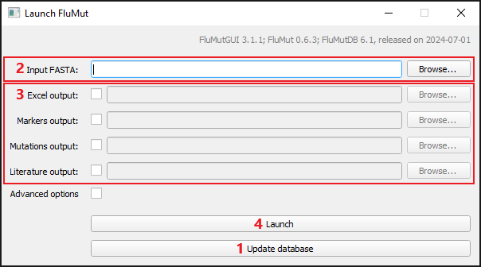
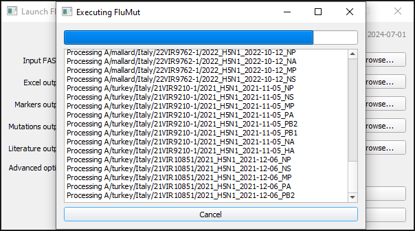
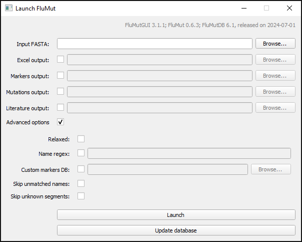

# GUI usage

## Basic Usage

FluMutGUI is very simple to use:

1. Select the FASTA files you want to analyze (learn more [here](./input-file)).
   You can select more than one file at once with `Browse...`; in the text box the paths are separated by `;`.
1. Select which [outputs](../output) you want by ticking their checkboxes.
   Each output is named after the first FASTA file; you can change the file name or choose another one with `Browse...`.
1. Click `Launch`

FluMut will analyze your samples and will create the selected outputs.
A progress window shows the progress of the analysis and its messages: warnings, such as the [quality checks](input-file#quality-checks), and errors are highlighted in red.

## Updates

FluMutGUI uses the database shipped with it.
When a newer FluMut version (and so a newer database) is available, a notice with a link to the new release appears in the top right corner of the main window, below the FluMut version.
See [Updates](../installation#updates) to learn how to update.

## Advanced options

By checking the `Advanced options` flag you can access these options:

- `Relaxed`: same as the [`--relaxed` CLI option](./usage-cli#analysis-options)
- `Name regex`: tick it to change the regular expression used to parse FASTA headers, same as the [`--name-regex` CLI option](./usage-cli#input-options)

{: .note}
Some CLI options, such as using a custom database, are available only in the [CLI version](./usage-cli).
